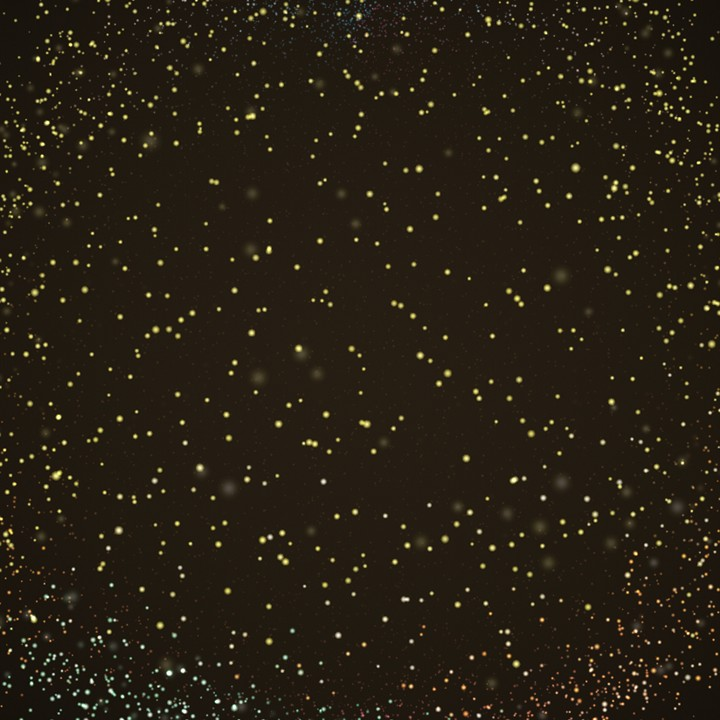

# CatMusic

**一只爱听歌的猫。** 一个本地优先的 Android 音乐播放器。

Kotlin · Jetpack Compose · Media3 · QWEA0 Liquid Glass · MusicDL · WebGL

<p align="center">
  
</p>
<p align="center"><sub>原创 WebGL 粒子场演示 · 合成封面，非真实专辑或歌词</sub></p>

## 公开仓库说明

这是 CatMusic 的公开源码整理版，不是作者本地安装包的逐字节副本。

- **Sonic Topography 音浪源码不在本仓库中。** 上游的 Non-Commercial Learning License 只允许非商业学习、研究和个人使用，不授权公开再分发源码。因此 `index.html`、`bundle.js`、`style.css` 与 `sonic-web/` 被有意排除。缺少这些文件时，音浪入口会回退到原生歌词页；如你已取得上游作者的书面许可，请按 [docs/SONIC-ASSETS.md](docs/SONIC-ASSETS.md) 自行加入。
- **不包含**：release 签名密钥、真实微信赞赏二维码（仓库内是不可扫描的占位图）、任何 APK、作者的个人音乐/封面/歌词、下载缓存，以及 MusicDL 上游参考项目。
- **源代码公开，但不是 OSI 开源许可。** CatMusic 原创代码采用 **PolyForm Noncommercial 1.0.0**；第三方组件保留各自许可证，详见 [LICENSE](LICENSE) 与 [NOTICE.md](NOTICE.md)。免费发布不等于可以商业使用或再分发受限的第三方源码。

## 简介

CatMusic 是一个离线优先、没有账号和遥测的 Android 本地音乐播放器。它会把导入的音频复制到应用私有目录，支持 LRC 歌词、自定义封面、歌单、聆听统计和 Media3 后台播放；界面使用真正的 QWEA0 Liquid Glass 液态玻璃和跟随封面的动态色场。它还带有一个基于 MusicDL 思路的在线搜索页，可以从多个公开音乐来源检索、试听并按音质下载，供个人非商业使用。

作者本地完整版还包含 Sonic Topography 3D 音浪地形和作者原创的 10,000 点 WebGL 粒子音浪。Sonic 地形代码因许可证原因不在本仓库；粒子渲染器源码保留在 [`particle.js`](app/src/main/assets/sonic/particle.js)。

## 功能亮点

- **本地优先**：导入音频、LRC/TXT 歌词与封面，复制到应用私有目录；删除歌曲只删软件内副本，不改动手机原文件。
- **完整播放体验**：Media3 / ExoPlayer 后台播放、通知栏与锁屏控制、上/下一首、列表/单曲/循环、定时暂停与淡入淡出。
- **音乐馆、歌单与统计**：搜索、编辑歌曲信息、自定义封面、歌单增删排序、累计/今日/近 7 天聆听统计。
- **液态玻璃界面**：QWEA0 Liquid Glass Android（MIT）真实折射与传感器高光，配合封面主色渐变的原生动态背景。
- **歌词**：原生渐变歌词页与 LRC 高亮；支持双语行、单曲歌词偏移校准与任意歌词跳转。
- **MusicDL 在线模块**：网易云、QQ、咪咕、酷我、千千、酷狗、JOOX、5sing、Jamendo 九源检索；搜索优先解析最高可用音质与真实体积；可保存到播放器或系统下载目录。在线接口由第三方公开服务提供，仅用于个人非商业用途。
- **音浪**：作者本地完整版包含 Three.js 音浪地形与原创 WebGL 粒子场。公开仓库提供粒子场源码 `particle.js` 与效果说明，但不提供 Sonic Topography 页面代码（许可证限制）。
- **隐私**：无需账号；本地曲库、封面、歌词、歌单和统计不会上传；音浪页使用本地 WebView 且禁止网络；在线页只发送搜索关键词与来源标识；不申请麦克风权限。

## 技术栈

| 层 | 使用 |
|---|---|
| 语言 / UI | Kotlin 2.0.21、Jetpack Compose |
| 播放 | AndroidX Media3 / ExoPlayer、MediaSessionService |
| 音频视觉 | 本地 PCM 八频段分析、WebGL 粒子场 |
| 视觉 | QWEA0 Liquid Glass Android（MIT）、跟随封面的原生渐变背景 |
| 在线音乐 | 自带 MusicDL Lite WebView 页面 + Kotlin/Java 网络桥 |
| 存储 | 应用私有目录、SharedPreferences、WebView localStorage |
| 构建 | Gradle 8.7、AGP、compileSdk 36、minSdk 26 |

## 快速开始

### 环境

- JDK 17 或 21（作者使用 JDK 21）
- Android SDK Platform 36 和 Build Tools 36
- Gradle Wrapper 随仓库提供

### 构建 Debug APK

```bash
git clone https://github.com/mao-niang520/catmusic.git
cd catmusic
```

创建 `local.properties`（不要提交）：

```properties
sdk.dir=/path/to/Android/Sdk
```

或在环境中设置 `ANDROID_HOME` / `ANDROID_SDK_ROOT`。

```bash
./gradlew :app:assembleDebug
```

Windows 使用 `gradlew.bat`。产物为 `app/build/outputs/apk/debug/app-debug.apk`。

### Release 签名

本仓库不包含作者的签名密钥，也不提供可直接安装的 APK。请创建你自己的 keystore，并在本地新建 `keystore.properties`：

```properties
storeFile=/path/to/your-release.jks
storePassword=********
keyAlias=your-alias
keyPassword=********
```

然后运行 `./gradlew :app:assembleRelease`。不要把 keystore 或 `keystore.properties` 提交到 Git。

### 可选：音浪资源

公开仓库有意不包含 Sonic Topography 音浪页面源码。音浪入口在缺少资源时会回退到原生歌词页。若你已获得上游许可，参见 [docs/SONIC-ASSETS.md](docs/SONIC-ASSETS.md)；否则建议在设置中关闭音浪，使用原生歌词页。

## 目录结构

```text
app/src/main/java/com/catmusic/app/   Kotlin 应用：曲库、播放、UI、在线桥
app/src/main/assets/musicdl/          MusicDL Lite 在线页面资源（PolyForm，非商业）
app/src/main/assets/sonic/particle.js 原创 WebGL 10,000 点粒子场
app/src/main/res/                     图标、字体、主题与界面资源
licenses/                             第三方许可证与声明
docs/                                 开发说明、Sonic 资源说明、合成演示图
```

## 隐私与数据

- 不需要账号、广告、分析上报或云端同步。
- 导入的音频、封面和歌词只保存在应用私有目录；除非用户主动使用在线页，否则不会联网。
- 在线页只把搜索关键词和所选来源发给第三方公开接口，不携带账号 Cookie，不上传本地文件。
- 音浪歌词页禁用网络加载；音频由本地 PCM 分析驱动，不使用麦克风。
- 在线内容、封面、歌词和音频的权利归各平台/权利人所有；本项目不托管、不再分发任何第三方音频。请遵守平台条款和当地法律，仅将在线功能用于个人非商业用途。

## 已知限制

- 在线来源不是官方开放 API，平台改版、地区限制或版权限制可能导致某一来源暂时不可用。
- 公开仓库缺少 Sonic Topography 音浪页面源码，完整音浪视觉效果需要另外取得上游授权并自行安装。
- 本项目采用非商业许可证；如需商业使用，请分别联系 CatMusic 原创代码与各第三方组件的权利人。

## 许可证

- **CatMusic 原创代码与文档**：PolyForm Noncommercial License 1.0.0，见 [LICENSE](LICENSE)。这是 source-available 的非商业许可，不是 OSI 开源许可。
- **第三方组件**：MusicDL / MusicDL Lite（PolyForm Noncommercial 1.0.0）、MusicSquare（Apache-2.0）、QWEA0 Liquid Glass Android（MIT）、Three.js（MIT）、Outfit 字体（SIL OFL）等，保留各自版权与许可。完整列表见 [NOTICE.md](NOTICE.md) 与 [`licenses/`](licenses/)。
- **Sonic Topography**：本仓库不包含其源码；其 Non-Commercial Learning License 仍适用于任何自行加入的副本。参见 [docs/SONIC-ASSETS.md](docs/SONIC-ASSETS.md)。

## 更多文档

- [完整开发与功能说明（含版本记录）](docs/DEVELOPMENT.zh-CN.md)
- [Sonic 音浪资源与许可证说明](docs/SONIC-ASSETS.md)
- [第三方声明](NOTICE.md)

## English

CatMusic is a local-first Android music player built with Kotlin, Jetpack Compose and Media3. It supports importing local audio, artwork and LRC lyrics, playlists, listening statistics, background playback, a QWEA0 liquid-glass UI, and an optional MusicDL-powered search/download page for personal noncommercial use. The developer build also includes a Sonic Topography soundwave scene and an original 10,000-point WebGL particle field.

This public export intentionally **excludes the Sonic Topography source** because its upstream Non-Commercial Learning License does not grant source redistribution rights. It also excludes signing keys, the real WeChat donation QR code (a non-scannable placeholder is included), APKs, personal media and downloaded music. CatMusic's original code is source-available under the **PolyForm Noncommercial License 1.0.0**; third-party components retain their own licenses. See [LICENSE](LICENSE) and [NOTICE.md](NOTICE.md). No affiliation with any music platform; no audio files are hosted or redistributed.

---

一个给爱听歌的猫做的小项目。感谢 MusicDL、MusicSquare、Sonic Topography、QWEA0 Liquid Glass、Three.js 以及所有公开音乐服务与开源作者。
