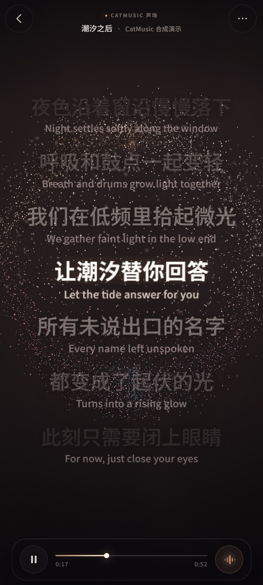
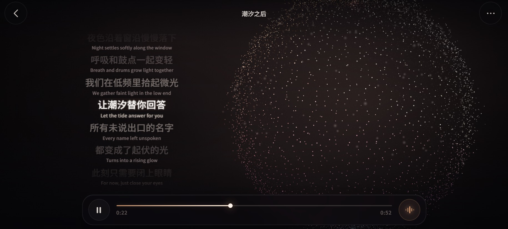

# CatMusic

**一只爱听歌的猫。** 一个本地优先的 Android 音乐播放器。

Kotlin · Jetpack Compose · Media3 · QWEA0 Liquid Glass · MusicDL · WebGL

<p align="center">
  
  
</p>
<p align="center"><sub>原创 WebGL 声场演示 · 合成封面与演示歌词，非真实专辑或歌词</sub></p>

## 简介

CatMusic 是一个离线优先、没有账号和遥测的 Android 本地音乐播放器。它会把导入的音频复制到应用私有目录，支持 LRC 歌词、自定义封面、歌单、聆听统计和 Media3 后台播放；界面使用真正的 QWEA0 Liquid Glass 液态玻璃和跟随封面的动态色场。它还带有一个基于 MusicDL 思路的在线搜索页，可以从多个公开音乐来源检索、试听，并按音质保存，供个人非商业使用。

最新版本为 **1.34.5**，安装包和校验值见下方「下载」。

## 1.34.5 更新

- **星潮只保留基础粒子**：删除球体中额外放大的光斑与漂浮亮点，不再随机放大小点；改为等高纬线环，沉浸档 64 行约 1 万点，每行点数按周长分配，所有基础粒子统一尺寸和亮度，球面呈规整的横向点阵。
- **歌词滑动调时间**：原生歌词页和音浪声场页都支持上下滑动歌词预览时间。向上快进、向下回退，顶部显示目标时间；松手后保留目标歌词，点击即跳转，3 秒内不点会自动回到当前播放行，播放本身不中断。
- **三点菜单渐入 / 渐出**：播放器右上角菜单可分别设置 0–2 秒的播放渐入与 App 内暂停渐出，步进 0.1 秒，0 秒即关闭，设置会持久保存。
- **保留此前的改进**：熔岩流体背景、背景预设即时切换、首页顶部黑色留白移除、音浪开启自动打开歌词、桌面歌词、在线连续播放、翻译与歌词滑动等。

## 下载

- [GitHub Releases](https://github.com/mao-niang520/catmusic/releases)
- 最新安装包：[CatMusic-v1.34.5.apk](https://github.com/mao-niang520/catmusic/releases/download/v1.34.5/CatMusic-v1.34.5.apk)
- 版本：`versionCode 56` / `versionName 1.34.5`
- SHA-256：`A897594F0E481A0667476DFB2586BD072FB4ABBA4F8A18ED017BECDBD1D0E0B9`
- 大小：4,418,997 字节

安装：

```powershell
adb install -r "CatMusic-v1.34.5.apk"
```

## 公开仓库说明

- **源代码公开，但不是 OSI 开源许可。** CatMusic 原创代码与文档采用 **PolyForm Noncommercial 1.0.0**。第三方组件保留各自许可证，详见 [LICENSE](LICENSE) 与 [NOTICE.md](NOTICE.md)。
- **完整声场源码在仓库内。** `app/src/main/assets/soundfield/` 包含页面结构、CSS、WebGL 渲染器、歌词交互和 Kotlin 桥接；没有来源不明或被限制再分发的场景代码。
- **赞赏二维码按作者要求公开。** 仓库内 `app/src/main/res/drawable-nodpi/donation_wechat.jpg` 与正式安装包中的二维码一致，不再使用占位图。
- **不包含**：release 签名密钥、`keystore.properties`、密码、作者的个人音乐 / 封面 / 歌词、下载缓存，以及 MusicDL 上游参考项目。安装包只作为 GitHub Release 附件提供，不提交进 Git 历史。
- 音浪页运行在离线 WebView 中，`blockNetworkLoads = true`；本地曲库、封面、歌词、歌单与统计不会上传。

## 功能亮点

- **本地优先**：导入音频、LRC/TXT 歌词与封面，复制到应用私有目录；删除歌曲只删软件内副本，不改动手机原文件。
- **完整播放体验**：Media3 / ExoPlayer 后台播放、通知栏与锁屏控制、上/下一首、列表 / 单曲 / 循环、定时暂停；播放渐入与 App 内暂停渐出可在三点菜单分别设置。
- **音乐馆、歌单与统计**：搜索、编辑歌曲信息、自定义封面、歌单增删排序、累计 / 今日 / 近 7 天聆听统计；音乐馆支持列表 / 唱片两种排列。
- **液态玻璃界面**：QWEA0 Liquid Glass Android（MIT）真实折射、色散与传感器高光，配合跟随封面的原生动态背景。
- **熔岩流体背景**：主界面与播放器默认使用品红 / 深紫 MetaBall 液体，Canvas 保证所有系统可见，Android 13+ 叠加 RuntimeShader（AGSL）增强。
- **歌词**：原生渐变歌词页、音浪声场页与 LRC 高亮；支持双语行、单曲歌词偏移校准、点击跳转及上下滑动预览时间。
- **桌面歌词**：退出 CatMusic 后可在桌面或其他应用上方显示同步原文与译文；支持描边 / 透明 / 卡片 / 霓虹四种风格、颜色、字号与锁定点击穿透。
- **原创声场**：
  - **星潮**：约一万个封面取色光点组成的规则纬线球。低频让球壳呼吸，鼓点将它炸成空心云团；左右拖动可连续旋转 360°，双指张合缩放。
  - **回声**：原创透视声波光带，多层涟漪随低频与节拍起伏；鼓点向外推开光圈，颜色同样来自当前封面。
  - 效果选择、每个效果各自的视角与缩放、鼓点律动、歌词行数（3–10 行）、陀螺仪开关与灵敏度都会保存在本机。
  - 横屏时歌词在左、声场在右；歌词始终位于声场前方，可上下滑动预览时间并点击跳转。
  - WebGL 不可用或页面加载超时时自动回退到原生歌词页。
- **MusicDL 在线模块**：网易云、QQ、咪咕、酷我、千千、酷狗、JOOX、5sing、Jamendo 九源检索；搜索阶段解析可用音质与真实体积；可按标准 / 较高 / 无损保存到播放器或系统下载目录。
- **在线与本地播放不互相打断**：切到「在线」或切换标签不会暂停本地播放；只有在线试听真正开始时，本地播放器才淡出暂停。
- **安全删除**：在软件中删除歌曲只删除应用私有副本、封面、歌词和歌单引用；手机原文件永远不会被软件删除。
- **隐私**：无需账号、广告或分析上报。只有主动使用「在线」页，或手动开启歌词自动翻译时才联网；本地曲库、封面、歌词、歌单与统计不上传。声场页不申请麦克风权限。

## 使用

1. 导入音频、LRC/TXT 歌词和封面；点击歌曲播放，点击底部媒体栏进入全屏播放页。
2. 点击播放页底部左侧「词」进入歌词；开启音浪会自动进入歌词 / 声场页，但打开歌词不会自动开启音浪。
3. 顶部左侧返回、右侧三点菜单；底部左侧播放/暂停，中间进度线，右侧音浪开关。三点菜单中的「播放渐入 / 渐出」可分别设置 0–2 秒的音量过渡。
4. 声场顶部左侧返回，右侧打开设置菜单；底部左侧播放 / 暂停，中间进度线，右侧关闭声场。
5. 声场菜单提供：星潮 / 回声切换、鼓点律动、歌词行数、陀螺仪灵敏度、姿态陀螺仪、重置视角、歌词校准、导入 / 更换歌词、关闭声场和返回封面。
6. 声场/歌词页上下拖动歌词可预览时间，点击跳转到目标歌词，3 秒不点自动回到当前行；轻点歌词也能直接跳转。星潮可左右拖动连续旋转 360°，松手带短暂惯性，上下拖动倾斜视角，双指张合缩放；轻点进度线或横向拖动跳转。
7. 音乐馆「全部音乐」右侧可选择「列表 / 唱片」。唱片模式里拖动下方进度条选歌，点选中的方形唱片会把它抽出；点唱片左下角的播放按钮开始播放。
8. 播放页点「浮」（或菜单、媒体通知里的「桌面歌词」）并授权后，退出 CatMusic 即可看到悬浮歌词。闲置时只有文字；点歌词弹出样式 / 调色 / 字号 / 锁定 / 关闭工具栏，6 秒后自动收起。
9. 设置 →「声场与动效」→「动效刷新率」：默认「自适应」会在静止时降帧省电，滑动、切歌、歌词换行或菜单操作时临时升到 60fps。

## 技术栈

| 层 | 使用 |
|---|---|
| 语言 / UI | Kotlin 2.0.21、Jetpack Compose |
| 播放 | AndroidX Media3 / ExoPlayer、MediaSessionService |
| 音频视觉 | 本地 PCM 八频段分析、自定义 WebGL 点精灵 / 光带着色器 |
| 视觉 | QWEA0 Liquid Glass Android（MIT）、MetaBall 原生流体背景、封面主题色场 |
| 在线音乐 | 自带 MusicDL Lite WebView 页面 + Kotlin/Java 网络桥 |
| 存储 | 应用私有目录、SharedPreferences、WebView localStorage |
| 构建 | Gradle 8.7、AGP、compileSdk 36、minSdk 26 |

## 快速开始

### 环境

- JDK 17 或 21（作者使用 JDK 21）
- Android SDK Platform 36 和 Build Tools 36
- Gradle Wrapper 随仓库提供

### 构建 Debug APK

```bash
git clone https://github.com/mao-niang520/catmusic.git
cd catmusic
```

创建 `local.properties`（不要提交）：

```properties
sdk.dir=/path/to/Android/Sdk
```

或在环境中设置 `ANDROID_HOME` / `ANDROID_SDK_ROOT`。

```bash
./gradlew :app:assembleDebug
```

Windows 使用 `gradlew.bat`。产物为 `app/build/outputs/apk/debug/app-debug.apk`。

### Release 签名

本仓库不包含作者的签名密钥。请创建你自己的 keystore，并在本地新建 `keystore.properties`：

```properties
storeFile=/path/to/your-release.jks
storePassword=********
keyAlias=your-alias
keyPassword=********
```

然后运行 `./gradlew :app:assembleRelease`。不要把 keystore 或 `keystore.properties` 提交到 Git。

## 目录结构

```text
app/src/main/java/com/catmusic/app/   Kotlin 应用：曲库、播放、UI、在线桥
app/src/main/assets/musicdl/          MusicDL Lite 在线页面资源（PolyForm，非商业）
app/src/main/assets/soundfield/       原创声场：HTML / CSS / WebGL / 桥接
app/src/main/res/                     图标、字体、主题与界面资源
licenses/                             第三方许可证与声明
docs/                                 开发说明、声场说明、合成演示图
```

更多技术细节：

- [声场实现与交互说明](docs/SOUNDFIELD.md)
- [完整开发与功能说明](docs/DEVELOPMENT.zh-CN.md)

## 已知限制

- 在线来源是第三方公开接口，平台改版或地区/版权限制可能让个别来源暂时不可用；不托管、不再分发音频。
- 在线试听是 WebView 内的 HTML5 音频，不是本地 Media3 队列；需要后台播放时请先把在线歌曲保存到本地曲库。
- 系统媒体通知里的「桌面歌词」按钮能否直接显示由厂商媒体控件决定；不显示时仍可从播放页的「浮」入口开启。
- WebGL 不可用或页面握手超时时，会自动回退到原生歌词页，播放功能不受影响。
- 声场是视觉功能，不影响音频解码与播放；极低端设备的「极致」档可能发热或降帧，可切回「轻 / 标准」。

## 许可与致谢

- CatMusic 原创代码与文档：PolyForm Noncommercial 1.0.0。
- MusicDL / MusicDL Lite：PolyForm Noncommercial 1.0.0；MusicSquare：Apache-2.0；QWEA0 Liquid Glass Android：MIT；Outfit：SIL OFL 1.1。
- 新的声场页面、星潮与回声着色器由本项目自行实现，不包含 Sonic Topography 或 Three.js 源码。
- 感谢 MusicDL、MusicSquare、QWEA0 Liquid Glass、所有公开音乐服务与开源作者。

一个给爱听歌的猫做的小项目。
